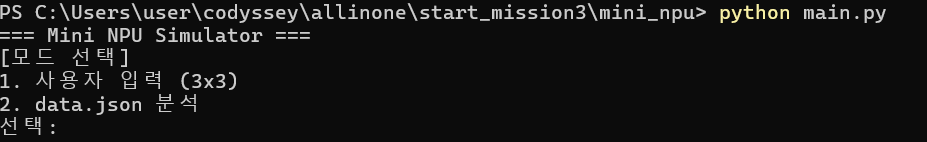
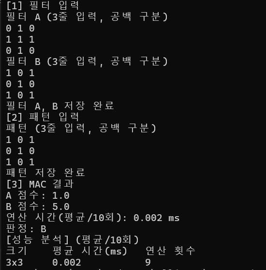
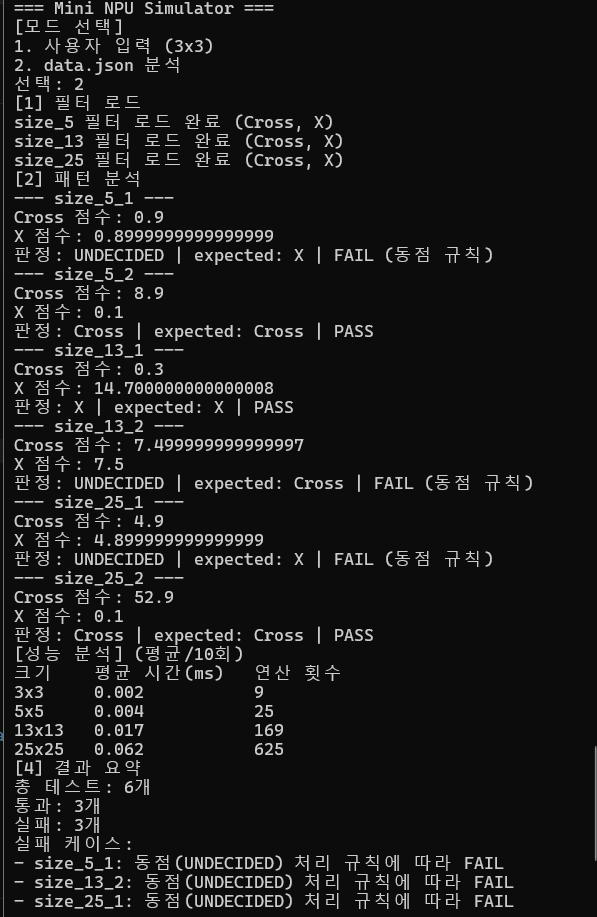
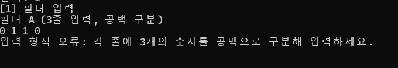
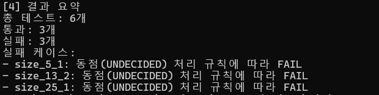

# Mini NPU Simulator

### AI가 계산하는 방식을 흉내 내는 작은 계산기 만들기

## 1. 프로젝트 소개

이 프로젝트는 컴퓨터가 그림의 모양을 눈으로 보는 대신, **숫자로 이루어진
2차원 배열**을 이용해 패턴을 구분하는 원리를 구현한 프로그램이다.

사람은 십자가(+)와 X 모양을 보면 쉽게 구별할 수 있지만, 컴퓨터는 그림의
모양을 사람처럼 직관적으로 이해하지 못한다. 그래서 그림을 0과 1로
이루어진 배열로 바꾸고, 미리 정해 둔 기준 배열인 **필터(Filter)**와
비교한다.

이때 사용하는 핵심 계산 방법이 **MAC(Multiply-Accumulate) 연산**이다.
입력 패턴과 필터의 같은 위치에 있는 숫자를 곱한 다음, 그 결과를 모두
더해 점수를 만든다. 점수가 더 높은 필터가 입력 패턴과 더 비슷하다고
판단한다.

이번 프로젝트에서는 이 원리를 파이썬으로 직접 구현하고, 3×3 사용자 입력
모드와 `data.json` 분석 모드를 제공하는 Mini NPU 시뮬레이터를 만들었다.

## 2. 프로젝트 목표와 구현 기능

| 구분 | 구현 내용 |
| --- | --- |
| 사용자 입력 모드 | 3×3 필터 A, B와 패턴을 입력받아 MAC 점수 계산 및 판정 |
| JSON 분석 모드 | `data.json`의 필터와 패턴을 불러와 케이스별 판정 |
| 입력 및 데이터 검증 | 행·열 개수, 숫자 형식, 배열 크기, 키와 라벨 형식 확인 |
| 점수 비교 | 허용오차 `epsilon`을 사용해 동점 여부 판단 |
| 성능 분석 | MAC 연산을 10회 반복 측정하고 평균 시간과 연산 횟수 출력 |
| 결과 요약 | 전체 테스트 수, 통과 수, 실패 수와 실패 사유 출력 |

프로그램은 Python 표준 라이브러리인 `json`, `time`만 사용한다. MAC
계산은 NumPy 같은 외부 라이브러리 없이 반복문으로 직접 구현했다.

## 3. 핵심 개념 이해하기

### 3-1. 패턴과 필터

-   **패턴(Pattern)**: 컴퓨터가 구분해야 하는 입력 모양을 숫자 배열로
    표현한 것이다.
-   **필터(Filter)**: 십자가나 X처럼 특정 모양을 판별하기 위해 미리
    준비한 기준 배열이다.

예를 들어 3×3 십자가 패턴은 다음과 같이 나타낼 수 있다.

``` text
0 1 0
1 1 1
0 1 0
```

십자가 필터와 X 필터를 각각 준비한 뒤 입력 패턴과 비교한다.

### 3-2. MAC(Multiply-Accumulate) 연산

MAC은 Multiply(곱하기)와 Accumulate(누적해서 더하기)를 합친 말이다.

입력 패턴과 필터를 같은 위치끼리 곱하고 모든 결과를 더한다.

예를 들어 십자가 패턴과 십자가 필터를 비교하면 같은 위치의 1끼리 곱해져
점수가 5가 된다. 반면 같은 패턴을 X 필터와 비교하면 점수는 1이 된다.
따라서 십자가 필터의 점수가 더 높으므로 십자가라고 판단할 수 있다.

``` text
입력 패턴       십자가 필터       위치별 곱셈
0 1 0           0 1 0             0 1 0
1 1 1     ×     1 1 1      =      1 1 1
0 1 0           0 1 0             0 1 0

점수 = 0+1+0+1+1+1+0+1+0 = 5
```

이 프로그램은 이 계산을 `MACEngine` 클래스의 `mac()` 함수에서 수행한다.

### 3-3. NPU란?

NPU(Neural Processing Unit)는 인공지능 연산을 빠르게 처리하기 위해
만들어진 전용 프로세서다. AI는 많은 데이터에 대해 곱셈과 덧셈을 반복하기
때문에 이러한 연산을 효율적으로 처리하는 장치가 필요하다.   
💡 수천 개의 MAC을 동시에(병렬) 처리하도록 만든 AI 전용 칩이 NPU

이번 프로그램은 NPU가 활용하는 그 핵심 원리(MAC)를 **반복문**으로 직접 흉내 내는 시뮬레이터다.

### 3-4. 라벨 정규화

같은 의미의 라벨도 데이터에 따라 `+`, `cross`, `CROSS`처럼 다르게 기록될
수 있다. 이 상태로 비교하면 같은 의미인데도 서로 다른 값으로 판단할 수
있다.

그래서 프로그램에서는 라벨을 `Cross` 또는 `X`라는 두 가지 표준 형태로
통일한다. 이를 **라벨 정규화(Normalization)**라고 한다.

### 3-5. 부동소수점 오차와 Epsilon

컴퓨터가 소수를 계산할 때는 아주 작은 오차가 생길 수 있다. 예를 들어
수학적으로 같은 값이어도 컴퓨터 내부에서는 `0.9`와
`0.8999999999999999`처럼 다르게 표현될 수 있다.

따라서 두 점수를 `==`로 바로 비교하지 않고, 두 점수의 차이가 아주 작은
기준값보다 작으면 동점으로 처리한다. 이 기준값을 허용오차(Epsilon)라고
한다.

이 프로그램에서는 다음 기준을 사용한다.

``` python
EPSILON = 1e-9

if abs(score_a - score_b) < self.EPSILON:
    return "TIE"
```

두 점수의 차이가 `1e-9`보다 작으면 `TIE`를 반환한다. 동점이면 어느
필터가 더 비슷한지 결정할 수 없으므로 JSON 분석에서는 `UNDECIDED`로
판정한다.

## 4. 프로그램 실행 방법

### 4-1. 준비 사항

-   Python 3.8 이상, 표준 라이브러리(`json`, `time`)만 사용 (NumPy 등 금지)
-   `main.py`
-   JSON 분석 모드를 사용할 경우 `data.json` 

`main.py`와 `data.json`을 같은 폴더에 둔다.

### 4-2. 실행 명령어

터미널 또는 명령 프롬프트에서 프로젝트 폴더로 이동한 뒤 다음 명령어를
입력한다.

``` bash
python main.py
```

### 4-3. 실행 모드 선택

- 모드 1 (사용자 입력): 3×3 필터 2개(A, B)와 패턴을 직접 입력 → MAC 점수·시간·판정 출력 
- 모드 2 (json 파일): `data.json`의 5×5 / 13×13 / 25×25 필터·패턴을 일괄 판정 → PASS/FAIL, 성능표, 결과 요약 


> 프로그램을 실행하면 다음 메뉴가 나타난다.



``` text
=== Mini NPU Simulator ===

[모드 선택]
1. 사용자 입력 (3x3)
2. data.json 분석
선택:
```

-   `1` 입력: 필터 A, 필터 B, 패턴을 각각 3줄씩 입력한다.
-   `2` 입력: `data.json`에서 필터와 패턴을 불러와 여러 테스트 케이스를
    분석한다.

### 4-4. 사용자 입력 예시

필터 2가지, 패턴 1가지 입력 - 한 줄에 3개의 숫자를 공백으로 구분해서 입력



``` text
필터 A
0 1 0
1 1 1
0 1 0

필터 B
1 0 1
0 1 0
1 0 1

패턴
1 0 1
0 1 0
1 0 1
```

이 경우 패턴은 필터 B와 더 비슷하므로 B의 점수가 더 높게 나온다.

### 4-5. json 파일 입력 예시

입력 없이 자동으로 필터 로드(data.json) → 패턴 분석 → 성능 분석 → 결과 요약 순서로 진행




## 5. 코드 구성과 핵심 기능

프로그램은 역할에 따라 세 개의 클래스로 나누어 작성했다. 계산, 데이터
관리, 전체 실행 흐름을 분리해 각 클래스가 맡은 일을 명확하게 했다.

| 클래스 | 역할 | 주요 함수 |
| --- | --- | --- |
| `MACEngine` | 점수 계산, 점수 비교, 시간 측정 | `mac()`, `compare_scores()`, `measure_time()` |
| `DataManager` | 배열 저장·조회, 입력 처리, JSON 로드, 라벨 통일 | `store_matrix()`, `get_matrix()`, `input_matrix()`, `load_json()`, `normalize_label()` |
| `NPUSimulator` | 메뉴와 실행 순서 관리, 패턴 분석, 결과 출력 | `run()`, `run_mode1()`, `run_mode2()`, `analyze_pattern()` |

        
        NPUSimulator ──(계산 요청)──▶ MACEngine
              │
              └────(데이터 요청)───▶ DataManager ──▶ data.json
        

### 5-1. MAC 점수를 계산하는 `mac()` 함수 : MACEngine.mac()

``` python
def mac(self, pattern_list, filter_list):
    n = len(pattern_list)
    total = 0.0

    for row in range(n):
        for col in range(n):
            total += pattern_list[row][col] * filter_list[row][col]

    return total
```
💡이중 for 문으로 모든 칸(N×N)을 한 번씩 돌며 곱한 값을 total 에 쌓습니다.

**코드 이해하기**

1.  `n`에 패턴의 한 변의 크기를 저장한다.
2.  바깥쪽 `for`문은 행을 이동한다.
3.  안쪽 `for`문은 열을 이동한다.
4.  같은 위치의 패턴 값과 필터 값을 곱한다.
5.  곱한 값을 `total`에 계속 더한다.
6.  모든 칸을 계산한 뒤 최종 점수를 반환한다.

즉, 이중 반복문으로 2차원 배열의 모든 위치를 확인하면서 MAC 연산을
수행한다. 이 함수가 프로그램에서 가장 핵심적인 계산 기능을 담당한다.


### 5-2. 두 점수를 비교하는 `compare_scores()` 함수 : (epsilon 정책)

``` python
def compare_scores(self, score_a, score_b):
    if abs(score_a - score_b) < self.EPSILON:
        return "TIE"
    if score_a > score_b:
        return "A"
    return "B"
```

두 점수의 차이를 먼저 확인한다. 차이가 허용오차보다 작으면 동점인
`TIE`를 반환한다. 동점이 아니면 더 높은 점수를 가진 쪽인 A 또는 B를
반환한다.

### 5-3. 입력값을 검사하는 `parse_row()` 함수 : 입력 검증  


``` python
def parse_row(self, line, size):
    token_list = line.split()

    if len(token_list) != size:
        raise ValueError("열 개수 불일치")

    row_list = []
    for token in token_list:
        row_list.append(float(token))

    return row_list
```

입력한 한 줄을 공백 기준으로 나누고, 숫자의 개수가 정해진 크기와 같은지
확인한다. 그다음 각 값을 `float()`으로 변환한다.

숫자의 개수가 맞지 않거나 숫자로 바꿀 수 없는 값이 있으면 `ValueError`가
발생한다. `input_matrix()`에서는 이 오류를 잡아서 안내 문구를 출력하고
다시 입력받는다.

``` python
def input_matrix(self, title, size=3):
    
    print("%s (%d줄 입력, 공백 구분)" % (title, size))
    matrix_list = []
    
    while len(matrix_list) < size:ㄴ
        line = input()
        try:
            matrix_list.append(self.parse_row(line, size))
        except ValueError:
            print("입력 형식 오류: 각 줄에 %d개의 숫자를 공백으로 구분해 입력하세요." % size)
    return matrix_list
```




### 5-4. 라벨을 통일하는 `normalize_label()` 함수 : 라벨 정규화

``` python
LABEL_TABLE = {"+": "Cross", "CROSS": "Cross", "X": "X"}

def normalize_label(self, raw):
    key = str(raw).strip().upper()

    if key not in self.LABEL_TABLE:
        raise ValueError("알 수 없는 라벨")

    return self.LABEL_TABLE[key]
```

>입력된 라벨의 앞뒤 공백을 제거하고 대문자로 바꾼 다음, 미리 만들어 둔
>`LABEL_TABLE`에서 표준 라벨을 찾는다.

>예를 들어 `cross`, `CROSS`, `+`는 모두 `Cross`로 통일되고, `x`는 `X`로
>통일된다. 표준 라벨로 통일하면 데이터의 표현 방식이 달라도 정확하게
>비교할 수 있다.

>번역표에 없는 값은 ValueError 를 일으켜 그 케이스만 FAIL 처리합니다.

### 5-5. JSON 데이터를 분석하는 `analyze_pattern()` 함수 : 패턴 1개 판정  

키에서 N 추출 → Cross/X 필터 선택 → 크기 검증
   → 각 필터와 MAC → epsilon 비교 → Cross / X / UNDECIDED
   → expected 도 표준 라벨로 통일 → 같으면 PASS, 다르면 FAIL

``` python
size = self.datamanager.extract_size(key)
pattern_list = case_dict["input"]

cross_list = self.datamanager.get_matrix(
    "size_%d_Cross" % size
)
x_list = self.datamanager.get_matrix(
    "size_%d_X" % size
)

self.datamanager.check_size(pattern_list, cross_list)
self.datamanager.check_size(pattern_list, x_list)

cross_score = self.macengine.mac(pattern_list, cross_list)
x_score = self.macengine.mac(pattern_list, x_list)

result = self.macengine.compare_scores(cross_score, x_score)
judge = {"A": "Cross", "B": "X", "TIE": "UNDECIDED"}[result]
```

이 함수는 JSON에 들어 있는 패턴 하나를 분석한다.

1.  케이스 이름에서 패턴의 크기를 알아낸다.
2.  해당 크기에 맞는 Cross 필터와 X 필터를 가져온다.
3.  패턴과 필터의 크기가 같은지 검사한다.
4.  두 필터에 대해 각각 MAC 점수를 계산한다.
5.  점수를 비교해 `Cross`, `X`, `UNDECIDED` 중 하나로 판정한다.
6.  판정 결과를 JSON의 `expected` 값과 비교해 `PASS` 또는 `FAIL`을
    출력한다.

extract_size(key) - patterns 키에서 크기 N을 추출
load_filters() - filters의 size_N과 매칭을 가능하게 하는 준비
analyze_pattern() - extract_size(), load_filters() 로 같은 크기의 필터를 꺼냄


**필터를 읽을 때**: 이름표를 size_13_Cross처럼 만들어 두면, 나중에 크기만 알면 바로 꺼낼 수 있습니다.
**패턴을 분석**할 때: size_13_1에서 N=13을 뽑아 위 이름표를 조립해 찾으면 됩니다.
키 규칙이 바뀌면: extract_size() 한 곳만 고치면 됩니다.


### 5-6. 연산 시간을 측정하는 `measure_time()` 함수

``` python
def measure_time(self, pattern_list, filter_list, repeat=10):
    total_seconds = 0.0

    for i in range(repeat):
        start = time.perf_counter()
        self.mac(pattern_list, filter_list)         # 이 구간만 잰다
        total_seconds += time.perf_counter() - start

    return total_seconds / repeat * 1000            # 초 → ms
```

MAC 연산을 기본 10회 반복하면서 걸린 시간을 측정한다.
`time.perf_counter()`를 사용해 연산 함수가 실행되는 구간만 측정하고,
전체 시간을 반복 횟수로 나누어 평균을 구한다.

마지막에 초 단위의 시간을 밀리초(ms)로 바꾸어 반환한다. 입력이나 출력,
파일 읽기 시간은 측정에 포함하지 않는다.


## 6. 오류 처리와 예외 상황 : try/except

프로그램이 잘못된 데이터 때문에 갑자기 종료되지 않도록 여러 검사를
넣었다.


| 상황 | 처리 방법 |
| --- | --- |
| 사용자 입력의 숫자 개수가 맞지 않음 | 안내 문구 출력 후 다시 입력 |
| 숫자로 변환할 수 없는 값 입력 | `ValueError`를 잡아 다시 입력 |
| JSON 파일을 읽을 수 없음 | 오류 메시지 출력 후 모드 종료 |
| JSON에 필요한 항목이 없음 | 해당 케이스를 실패 처리 |
| 패턴과 필터의 크기가 다름 | 해당 케이스를 실패 처리 |
| 알 수 없는 라벨 | 해당 케이스를 실패 처리 |
| 두 점수가 허용오차 안에서 같음 | `UNDECIDED`로 판정 |

``` python
for key, case_dict in pattern_dict.items():
    try:
        reason = self.analyze_pattern(key, case_dict)
    except ValueError as error:   ...   # 크기/라벨/키 형식 문제
    except KeyError as error:     ...   # 필요한 필터/항목 없음
    except TypeError:             ...   # 값 형식 이상
```

특히 JSON 분석 모드에서는 케이스마다 예외 처리를 하기 때문에 한 케이스에
문제가 생겨도 가능한 한 다음 케이스의 분석을 계속할 수 있다.

## 7. 성능 분석과 시간 복잡도

### 7-1. 연산 횟수

`mac()` 함수는 행과 열을 각각 반복하는 이중 반복문으로 작성되어 있다.

N×N 배열이라면 각 행에서 N개의 칸을 확인하고, 이러한 행이 N개 있으므로
전체 연산 횟수는 N×N, 즉 N²이다.

| 배열 크기 | MAC 연산 횟수 |
| --- | ---: |
| 3×3 | 9 |
| 5×5 | 25 |
| 13×13 | 169 |
| 25×25 | 625 |

따라서 이 프로그램의 MAC 함수는 입력 배열의 크기 N에 대해 **시간 복잡도
O(N²)**를 가진다.

### 7-2. 성능 측정 결과 해석

프로그램은 각 크기의 MAC 연산을 10회 반복한 뒤 평균 시간을 출력한다.
측정 결과는 컴퓨터의 성능이나 실행 환경에 따라 달라질 수 있다.

배열의 한 변이 커지면 계산해야 하는 칸의 수가 제곱에 비례해 증가한다.
예를 들어 5×5는 25회, 25×25는 625회 연산하므로 연산 횟수가 25배가 된다.

따라서 일반적으로 배열의 크기가 커질수록 연산 시간도 증가하는 경향을
보인다. 다만 실제 측정 시간은 컴퓨터 환경과 실행 상태에 따라 정확히 같은
비율로 증가하지는 않는다.

**이 코드의 성능 측정 방식에서 알아둘 점**

-   모드 1은 필터 A를 이용해 3×3 MAC 연산 시간을 측정한다.
-   모드 2는 3×3 예시 배열과 JSON에서 불러온 각 크기의 Cross 필터를
    이용해 성능을 측정한다.
-   모드 2의 성능 측정은 각 크기의 연산량을 비교하기 위한 별도 측정이며,
    모든 실제 테스트 패턴의 실행 시간을 측정한 것은 아니다.
-   측정값은 실행할 때마다 달라질 수 있으므로 실제 실행 결과를 기준으로
    기록해야 한다.

## 8. 결과 리포트

### 8-1. 테스트 결과

모드 2를 실행하면 각 패턴에 대해 Cross 점수, X 점수, 최종 판정, expected
값과 PASS/FAIL 결과가 출력된다.

마지막에는 전체 테스트 수, 통과 수, 실패 수와 실패한 케이스의 이름 및
이유가 요약된다.



| 항목 | 실행 결과 |
| --- | --- |
| 총 테스트 | 6 |
| 통과 | 3 |
| 실패 | 3 |
| 실패 케이스 및 사유 | 동점(UNDECIDED) 처리 규칙에 따라 FAIL |


### 8-2. 실패 원인 분석

실패가 발생하면 원인을 크게 데이터 문제, 판정 로직 문제, 수치 비교
문제로 나누어 살펴볼 수 있다.

1.  **데이터 및 스키마 문제**: JSON의 키 이름이 정해진 규칙과 다르거나
    `input`, `expected`처럼 필요한 항목이 없을 수 있다.
2.  **크기 불일치 문제**: 패턴과 필터의 행 또는 열 개수가 다르면 같은
    위치끼리 비교할 수 없다.
3.  **라벨 문제**: `+`, `cross`, `x`처럼 서로 다른 표현을 통일하지
    않으면 같은 의미의 정답도 다르게 비교될 수 있다.
4.  **수치 비교 문제**: 소수점 계산 오차 때문에 거의 같은 점수가 서로
    다른 값으로 저장될 수 있다.
5.  **동점 판정 문제**: 두 점수의 차이가 `1e-9`보다 작으면 프로그램은
    `UNDECIDED`로 처리한다. 이때 expected가 `Cross` 또는 `X`라면 FAIL이
    된다.

따라서 FAIL이 나왔다고 해서 항상 MAC 계산 코드가 잘못된 것은 아니다.
데이터 형식이 잘못되었는지, 배열 크기가 맞는지, 라벨이 통일되었는지,
동점 처리 기준에 해당하는지를 순서대로 확인해야 한다.

### 8-3. 성능 분석과 시간 복잡도 분석 O(N²)

이번 프로그램에서 가장 많은 반복 계산이 일어나는 부분은 `MACEngine`
클래스의 `mac()` 함수다. 이 함수는 행과 열을 각각 반복하는 이중 반복문을
사용한다.


- 측정 결과 (평균/10회, 한 번 실행한 값)

| 크기 | 평균 시간(ms) | 연산 횟수(N²) | 3×3 대비 연산량 |
|---|---|---|---|
| 3×3 | 0.001 | 9 | 1배 |
| 5×5 | 0.002 | 25 | 약 2.8배 |
| 13×13 | 0.010 | 169 | 약 18.8배 |
| 25×25 | 0.037 | 625 | 약 69.4배 |

N×N 배열에서는 총 N²개의 위치를 확인하므로 연산 횟수는 N²에 비례한다.
따라서 시간 복잡도는 O(N²)이다.

- 3×3 배열은 9번, 5×5 배열은 25번, 13×13 배열은 169번, 25×25 배열은
625번의 위치별 곱셈과 누적 덧셈을 수행한다.

- 배열 크기가 커질수록 계산해야 할 위치가 빠르게 늘어난다는 것을 확인할 수
있다. 이 때문에 실제 AI에서는 많은 MAC 연산을 효율적으로 처리하는 NPU가
중요하다.

- 프로그램에서 측정한 평균 시간은 `measure_time()` 함수가 10회 실행 시간을
더한 뒤 평균을 계산한 값이다. 측정 시간은 컴퓨터 환경에 따라 달라질 수
있지만, 연산 횟수와 함께 비교하면 데이터 크기가 계산량에 미치는 영향을
이해할 수 있다.

## 9. 이번 과제를 통해 이해한 점

이번 과제를 하기 전에는 컴퓨터가 그림을 사람처럼 보고 모양을 구분한다고
생각하기 쉬웠다. 하지만 실제로는 그림을 숫자 배열로 바꾸고, 기준이 되는
필터와 비교해 결과를 판단한다는 것을 알게 되었다.

특히 MAC 연산은 같은 위치의 숫자를 곱하고 모두 더하는 단순한 계산이지만,
AI에서 많은 데이터를 처리할 때 중요한 역할을 한다는 점이 인상 깊었다.

또한 프로그램을 만들 때는 계산 기능만 구현하는 것으로 끝나지 않는다는
것도 배웠다. 입력값을 검사하고, 데이터의 이름과 형식을 통일하고, 소수점
오차를 고려해야 프로그램이 더 정확하고 안정적으로 작동한다.

마지막으로 배열의 크기가 커질수록 연산 횟수가 N²에 따라 증가한다는 것을
직접 코드로 확인했다. 이번 과제를 통해 AI의 계산 원리뿐 아니라 데이터
관리, 오류 처리, 성능 분석의 중요성도 함께 이해할 수 있었다.

## 10. 더 생각해 보기

### Q1. 새 라벨 `'o'`가 추가된다면, 어떤 순서로 확장할까?

먼저 `'o'`가 기존 모양의 **별칭**인지 **새로운 모양**인지부터 확인합니다. 작업량이 달라지기 때문입니다.

1. **정규화:** `DataManager` 번역표에 한 줄을 추가합니다.
   - 별칭이면 `"O": "Cross"` → 여기서 끝
   - 새 모양이면 `"O": "Circle"` 같은 새 표준 라벨 추가
2. **판정:** 새 모양이면 "Cross vs X 중 하나"를 고르던 구조를 넓힙니다.
   - 해당 크기의 **모든 라벨 필터**로 점수 계산 → 가장 높은 라벨 선택
   - 1등과 2등의 차이가 epsilon보다 작으면 `UNDECIDED`
3. **출력:** 라벨 수만큼 반복해서 점수를 출력합니다.
4. **테스트:** 새 라벨 케이스, 필터 없는 크기, 모르는 라벨을 `data.json`에 추가해 확인하고, **기존 6개 케이스 결과가 그대로인지** 다시 봅니다.

> 정규화가 맨 앞인 이유: 이후 판정·출력·테스트가 새 라벨을 같은 이름으로 다룰 수 있기 때문입니다. 표기 규칙을 한 곳에 모아 둔 덕에 별칭이면 한 줄로 끝납니다.

### Q2. 1000×1000 패턴이면 어떤 문제가 생기고, 무엇을 먼저 최적화할까?

**발생하는 문제**

| 구분 | 내용 |
|---|---|
| 시간 | MAC 1회가 곱셈·덧셈 100만 번 (약 0.04초/회, 실행 환경에 따라 다름). 필터 2개 × 10회 반복 등으로 호출 수가 곱해져 급격히 느려짐 |
| 메모리 | 파이썬 리스트의 숫자는 칸마다 별도 객체 → 표 1개가 약 33MB. 패턴 1개 + 필터 2개면 100MB 가까이 |

**최적화 우선순위**

1. **저장 방식 변경:** 2차원 리스트 → 1차원 `array('d')`(길이 N²). 표 1개가 약 8MB로 약 4배 감소 (표준 라이브러리, 보너스 과제와 같은 방향)
2. **0은 건너뛰기:** 1000×1000 십자가에서 칠해진 칸은 1999개뿐. 0이 아닌 칸만 곱하면 N² → N 수준. 단, 값이 빽빽한 일반 사진에는 효과 없음
3. **패턴 한 번만 읽기:** Cross·X 점수를 한 번의 반복에서 함께 계산

> 어떤 최적화든 **같은 입력, 같은 반복 횟수로 전후를 재서** 확인한 뒤 채택합니다. 직관이 틀릴 수 있습니다. 1차원 배열 + `zip` 방식은 실측에서 0.07~0.09초로 오히려 더 느렸습니다.

### Q3. CPU 직렬 처리와 NPU 병렬 처리 관점에서 병목은 어디인가?

`mac()`은 칸을 하나씩 차례로 처리하는 **직렬 구조**이고, 병목은 세 곳입니다.

1. **연산 횟수 자체:** 칸 수(N²) × 필터 수 × 이미지 수를 줄 서서 처리 (측정에서도 시간이 칸 수에 비례, O(N²))
2. **반복마다 붙는 부담:** 파이썬은 곱셈 한 번마다 인터프리터가 일을 거쳐 부수 비용이 큼
3. **메모리 이동:** 칸마다 두 값을 가져와야 해서 계산보다 데이터 이동이 더 오래 걸릴 수 있음

**핵심:** 칸별 곱셈은 서로 독립이고 마지막 합산만 순서가 필요한 일입니다. NPU는 곱셈 유닛 수천 개로 이를 한꺼번에 처리해, 시간이 "칸 수에 비례"하는 대신 "칸 수 ÷ 유닛 수"에 가까워집니다. 병목의 정체는 **같은 단순 작업을 한 줄로 세워 처리하는 구조**이고, 그래서 CPU 대신 NPU가 만들어졌습니다.


## 11. 다른 학습자에게 설명할 때 기억할 핵심

-   컴퓨터는 그림을 숫자 배열로 바꾸어 처리한다.
-   필터는 특정 모양을 판별하기 위한 기준 배열이다.
-   MAC은 같은 위치의 숫자를 곱하고 모두 더해 점수를 만드는 연산이다.
-   점수가 높은 필터를 선택해 입력 패턴을 판정한다.
-   라벨 정규화는 서로 다른 표현을 같은 표준 이름으로 바꾸는 과정이다.
-   Epsilon은 아주 작은 소수점 오차를 고려해 동점을 판단하는 기준이다.
-   N×N 배열의 MAC 연산 횟수는 N²이므로 시간 복잡도는 O(N²)이다.
-   `MACEngine`은 계산, `DataManager`는 데이터 관리, `NPUSimulator`는
    전체 실행 흐름을 담당한다.

------------------------------------------------------------------------

**실행 파일:** `main.py`\
**JSON 데이터 파일:** `data.json` (JSON 분석 모드에서 필요)\
**사용 라이브러리:** Python 표준 라이브러리 `json`, `time`
